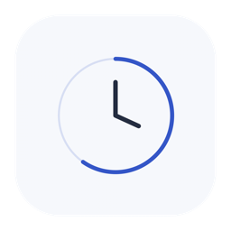
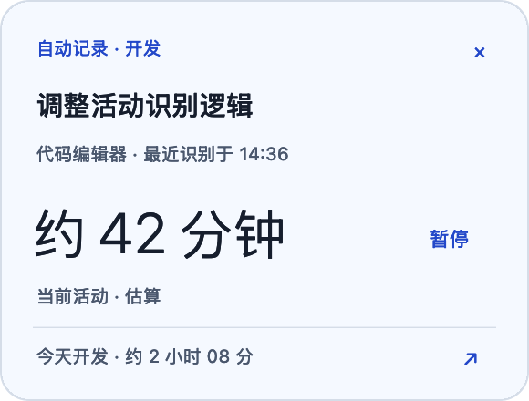
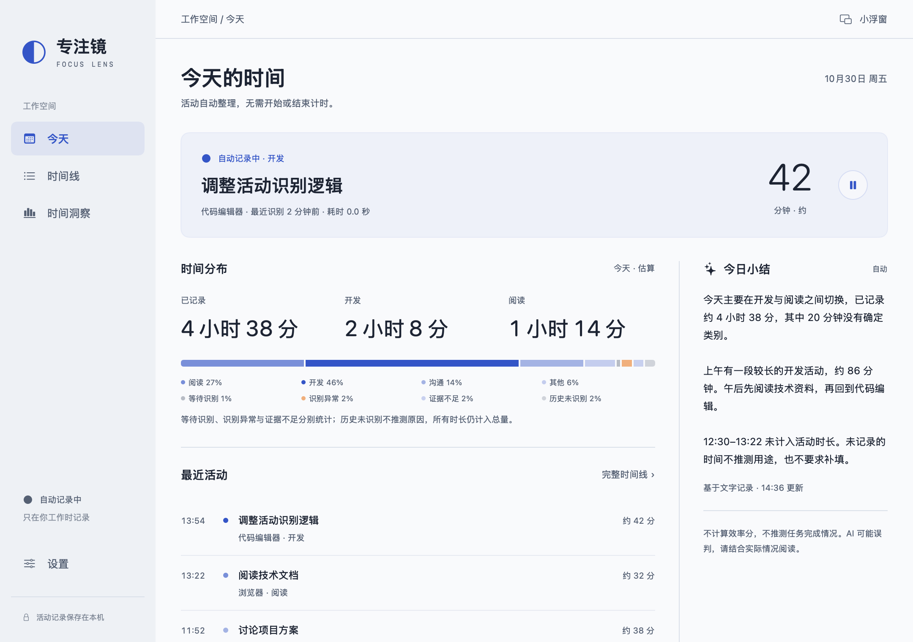

# 专注镜 · FocusLens



**一个自动记录和整理活动时间的原生 Mac 小工具。**

v0.4.0 将原来的自动记录和手动计时两套流程，收成单一的自动活动日志。你正常工作，应用间隔识别前台窗口，在本机整理活动与估算时长。无需开始一轮计时、填写目标、结束反馈、打分或确认空闲。

macOS 14+ · Apple 芯片 · SwiftUI / AppKit · 无第三方运行依赖 · [MIT](LICENSE)

[下载 v0.4.3 试用版](https://github.com/tangf-ai/focuslens/releases/tag/v0.4.3) · build 24 · [版本说明](docs/releases/v0.4.3.md)。应用为临时签名试用版，未进行 Apple 公证。

## 悬浮胶囊

常驻只占 **148 × 32 点**，显示当前活动类别与估算时长。鼠标停留时展开详情和操作，移开后自动收起；拖到屏幕左右边缘可缩成小把手。胶囊和操作按钮不获取键盘焦点，减少对其他应用的干扰。




以上为 2 倍原生渲染示例，使用虚构活动与模拟模型；实际常驻大小为 148 × 32 点。



截图来自独立原生预览，使用虚构活动和模拟模型，不包含个人记录，不代表真实模型准确率。

## 四个入口

- **今天**：当前活动、估算时长、今天的时间分布、最近记录与自动小结。
- **时间线**：按日浏览、类别筛选、只读详情和当天 JSON 导出。连续且同应用、同类别的相邻片段合并显示，不跨越空白时段。
- **时间洞察**：按周回看活动分布；未来日期留空，样本不足不判断长期趋势，不计算完成率或效率分。
- **设置**：记录与模型、排除应用、无操作策略、可选工作背景、独立的小结授权、主题、数据与旧版只读归档。

浮窗改为 148 × 32 点的原生悬浮胶囊，只常驻活动类别和估算分钟数。鼠标停留 350 毫秒后展开详情和操作，移开 500 毫秒后收起；可点击切换、拖动移位，贴近屏幕左右边缘时缩为 8 × 36 点的小把手。支持暂停/恢复、隐藏、返回今天与多屏位置恢复。浮窗不成为键盘焦点窗口；旧外观尺寸偏好保留在文件中，不再控制胶囊大小。不使用倒计时圆环或装饰动画。

## 首次开启

1. 在「设置 → 识别服务、排除应用与等待时间」填写支持图片输入的 Chat Completions 接口、模型与可选密钥。密钥单独保存在 macOS 钥匙串。
2. 保存配置，再点「测试图片理解」。测试仅使用内存生成的随机数字与颜色图，不截取桌面。
3. 在「今天」或设置中的开启面板允许 macOS 屏幕录制。系统可能要求重新启动应用。
4. 核对服务地址与模型，明确同意发送前台窗口截图后开启。更换接口、模型或密钥需要重新测试并确认。
5. 此后应用启动时沿用已授权的记录配置；没有设置系统登录项，不会代替用户授权权限。

默认每 2 分钟采样，支持 5 / 10 / 15 / 30 秒和 1 / 2 / 3 / 5 分钟。切换应用短暂等待窗口稳定后提前更新；模型较慢时不叠加任务、不补发排队请求。相同画面跳过重复调用，最长约 10 分钟重新分析。采样间隔不是模型响应速度保证。

### v0.4.1 未识别统计修复

- 时间分布和活动详情分别展示「等待识别」「识别异常」「证据不足」「历史未识别」。它们仍计入总记录时长，不通过隐藏异常来降低占比；时间线的「未识别」筛选包含这四类。
- 只有本次连续观察中、同一前台窗口、截图距离等待开始不超过 5 秒、且模型明确分类成功时，才将初始短等待吸收到该活动。换应用、换窗口、长等待、异常、低置信度、跨日、历史及人工记录不回填。不缓存应用类别来猜测新窗口用途。
- 同一应用切换前台窗口也会取消旧识别，防止旧窗口的迟到结果写到新窗口；只读取窗口标识，不新增截图。
- 失败后按 5 / 10 / 20 / 40 / 60 秒退避重试，不超过用户采样间隔；仍保持单任务、不堆积请求。切换应用、暂停和锁屏等原有取消门槛不变。
- 旧文件不批量迁移或重分类。仅在显示时根据明确的旧占位/异常标题分组；无法确定来源的保留「历史未识别」，不假定模型低置信度。
- 本机 `recognition-diagnostics.json` 保留最近 200 次识别的时间、阶段、结果和脱敏错误码，区分截图失败、HTTP 状态、网络错误、返回无效及取消。不保存截图、窗口标题、应用名、接口地址、密钥、响应正文或原始错误描述；诊断不发送给模型、不纳入活动导出。诊断文件损坏时不覆盖原文件，不阻断活动记录。

## 自动化，不取消隐私控制

- 只取前台应用一个普通窗口，不录制视频或音频，不同时分析所有显示器。
- 暂停、锁屏、睡眠、会话不可用、排除应用和专注镜自身前台时不采样；保留暂停、关闭和排除应用控制。
- 识别失败或证据不足保留「未识别」，不虚构活动，也不要求逐条纠错。
- 通用活动默认连续无操作 5 分钟后暂停；阅读 15 分钟、视频 30 分钟，也可配置继续记录。恢复操作后自动继续，不再弹出空闲确认或补记任务。
- 无操作只读取系统空闲时长，每 5 秒检查，不采集按键内容或鼠标轨迹。静静阅读可能误判，可调整等待策略。
- 时间为间隔观察的估算，不是精确工时、专注程度或绩效分；未观察的离线时间不补记。
- 没有网页级敏感内容检测，敏感网页请主动暂停。

截图通过 ScreenCaptureKit 取到后在内存中缩至最长边 1600 像素，JPEG 大小不超过约 1.1 MB，不写入应用图片文件、日志、历史或导出。图片请求不跟随重定向，禁用响应缓存。这只描述本应用的行为，不保证操作系统或远端服务无留存；请核对模型服务的数据政策。

### 可选的个人活动说明

设置中的「我的活动说明」可填写工作背景（最多 1000 字）和分类习惯（最多 2000 字）。鼠标离开输入框、切换输入框或离开设置时自动保存，只保存这两项说明，不提交其他模型设置；下次识别使用，不增加额外截图或模型调用。

说明会随正常截图请求发送到当前视觉服务。留空使用默认识别；不新增类别，证据不足仍保留未识别。历史记录及旧人工分类原样保留。

## 自动小结

默认关闭，需在设置中**另行同意发送文字记录**，不沿用旧版点击生成复盘的授权。

- 使用当前已验证、已确认的视觉模型服务，仅发送当天活动的时间、类别、应用名与文字概括，不重发历史截图。
- 每天首次打开「今天」、12:30 和 18:30 按需更新，全天最多 3 次；证据未变不发送。不是逐条活动请求。
- 每次请求前持久化时段和次数；失败、取消和应用退出均占用该次预算，本时段不自动重试。重启不会清空额度。
- 退出和睡眠时不唤醒电脑；回来后最多处理当前应到的时段，不补发全部错过的任务。
- 暂停、离开电脑、无操作暂停或关闭记录时不发送。关闭小结、暂停记录或换服务会取消在途请求，迟到结果不写入。
- 服务或密钥变化后停止发送，需要重新核对并同意。
- 生成失败保留上一份完整小结，展示失败与更新时间；流式中间内容不逐字写盘，不将未完成回复伪装为完整小结。
- 小结请求使用临时网络会话，不缓存响应、不跟随重定向。AI 仍可能误判，提示约束不等于模型质量保证。

## 从旧版升级

首次读取旧版数据时，先将活动文件、旧记录、配置和旧空闲日志复制到数据目录的 `backups/before-automatic-only-<UUID>/`，再写入 schema 3。

- 删除手动计时、倒计时浮窗、目标、标签管理、结束反馈、手动复盘与追问主流程，以及自动/手动来源选择。
- 旧记录、旧标签名称、原反馈与旧复盘保持只读，不混入自动统计。
- 进行中的旧轮次在迁移时停止并归档；待反馈草稿原样归档，不虚构完成情况或评分。
- 旧空闲日志尚未确认的时段不自动入账；旧版已经确认但因崩溃未完成落盘的决定仍按原稳定 ID 恢复，避免丢失之前明确确认的记录。
- 损坏或不支持的数据不覆盖；先备份再排查。

schema 3 不适合直接交给旧版本。**回退前先备份现状，再恢复迁移备份中的整套数据**，不要将新旧格式混写。备份不包含钥匙串密钥。

## 数据与导出

默认位置：`~/Library/Application Support/FocusLens/`。

| 文件 | 内容 |
| --- | --- |
| `focus-data.json` | 旧版只读记录、旧复盘和迁移信息 |
| `automatic-settings.json` | 视觉配置、可选说明与截图授权状态，不含密钥 |
| `automatic-activities/yyyy-MM-dd.json` | 自动活动文字；UTC 文件日期，界面按本机日期裁切 |
| `automatic-idle-periods.json` | 空闲边界及旧版确认日志，不再提供补记操作 |
| `automatic-summaries.json` | 小结授权签名、请求时段预算、完整小结与文字快照 |
| `recognition-diagnostics.json` | 最近 200 次脱敏识别诊断，本机保存，清除活动时先备份再清除 |
| `appearance-settings.json` | 独立的本机主题与浮窗偏好 |

设置中的「导出全部记录」统一导出自动活动（包含较早文件）、文字小结、旧版记录与空闲归档，不含截图或密钥。导出文件可能包含个人工作信息，请检查后再分享。遇到损坏文件时拒绝导出不完整结果。

「清除自动活动」需要二次确认：先完整备份，再关闭记录与小结，清除活动和小结；旧版归档保留。备份仍含原数据，这不是安全擦除，不会删除服务端数据。备份恢复仍需手动管理文件，没有自动恢复界面。

## 构建与验证

```sh
./scripts/test.sh
./scripts/build-app.sh /绝对路径/交付目录
```

构建产物为 `专注镜.app`，不会自动替换 `/Applications` 中的已安装版本。可使用独立数据目录测试，避免迁移真实记录：

```sh
open -n /绝对路径/专注镜.app --args --data-directory /绝对路径/隔离数据目录
```

原生界面截图验证使用虚构数据、假截图与假模型，不读取真实屏幕：

```sh
./scripts/native-preview.sh
```

图片默认写入 `.artifacts/automatic-only-preview/`。这些是 SwiftUI / AppKit 的实际渲染，不是网页替代品；不代表真实视觉模型验收或长时间资源测试。旧版资源记录见 [资源检查](资源检查.md)，历史验证见 [验证记录](验证记录.md)。

本版不包含跨设备同步、应用/网页屏蔽、系统勿扰联动或公开发布自动化。
