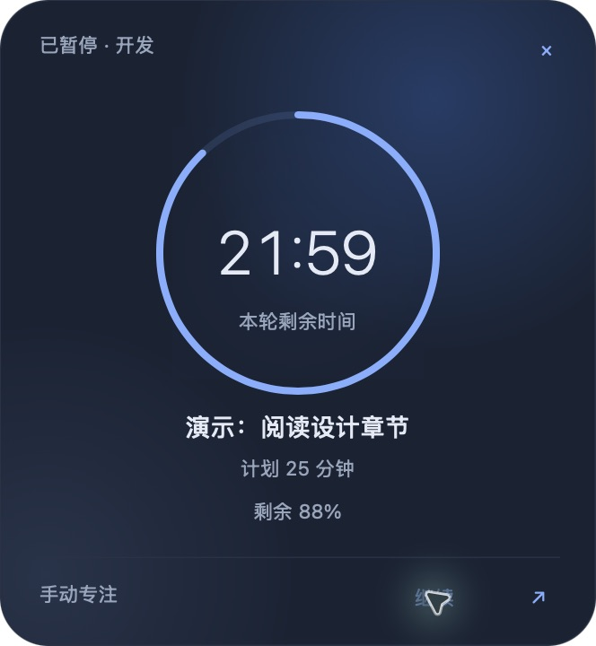
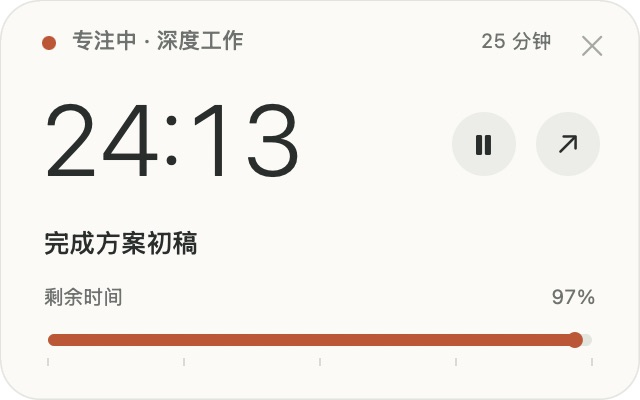
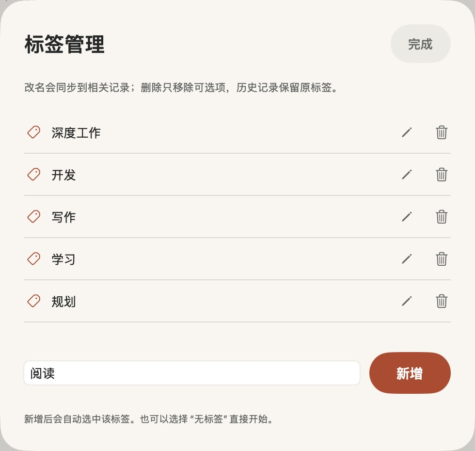
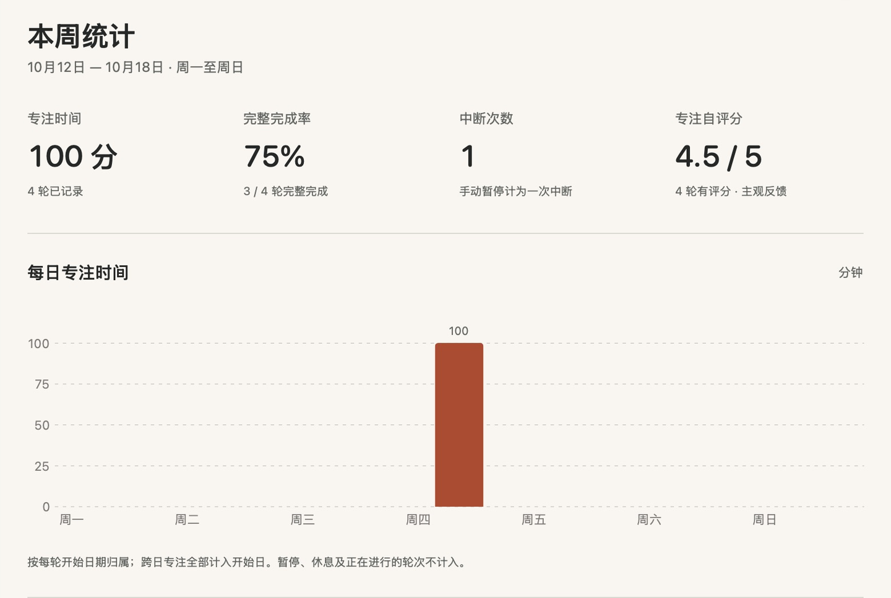
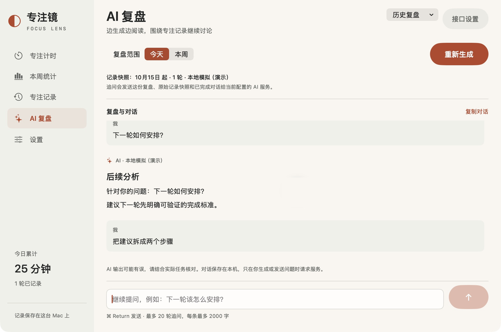

# 专注镜 · FocusLens



**一个能自动整理活动时间，也能手动专注计时的原生 Mac 小工具。**

连接你选择的视觉模型，间隔识别前台窗口，在浮窗里查看当前活动和估算时长；也可以继续用手动倒计时、目标与反馈。四套可切换主题，无内嵌浏览器。

[下载 Mac 试用版](https://github.com/tangf-ai/focuslens/releases/tag/v0.3.1) · [从源码构建](#源码与构建) · [MIT 开源](LICENSE)

macOS 14+ · Apple 芯片 · 原生 SwiftUI / AppKit



*深空主题 · 呼吸圆环，原生界面与虚构演示目标；默认主题为银雾浅色。*

- **专注时看得见**：主窗口最小化或关闭后，小浮窗仍会显示剩余时间。
- **结束后有记录**：保存目标完成情况、专注自评分和备注，按标签回看投入时间。
- **需要时再用 AI**：连接自己的兼容服务，实时阅读复盘结果，再继续提问、讨论下一步。

## 主题与动态浮窗

v0.3.0 新增「外观与浮窗」页面，主题选择会同步更新主窗口、侧栏、设置和两个浮窗，并单独保存在本机。

- **主题**：银雾、雨青、暮紫三套浅色，以及深空深色。默认银雾。
- **浮窗**：默认呼吸圆环，也可选柔光刻度。自动活动显示带「约」的估算时长，剩余刻度仅表示距休息建议的时间；手动计时显示本轮精确倒计时。
- **背景**：主题柔光或纯色；支持轻动态或静态。柔光使用原生图层渐变与缓慢位移，圆环有轻微明暗变化，不依赖网页、视频或粒子效果。
- **资源策略**：暂停、隐藏、遮挡、系统减少动态或低电量模式下停止装饰动画。时间文字与进度每秒只在可见浮窗局部更新，不发布全局状态，也不逐秒保存文件。
- **大小**：默认宽 332 点、圆角 27 点，可在「大小与圆角」调整。空目标收起目标行，仍保留标签；多屏位置记忆与拔屏恢复继续生效。

运行与暂停的本机短时资源采样见[资源检查](资源检查.md)。图层合成的系统与 GPU 开销不包含在应用 CPU 样本内。

## 自动记录：少一些启动和结束操作

v0.2.0 起提供独立的「自动记录」和「活动时间线」。默认关闭，需要你配置模型、通过图片理解测试、手动授权屏幕录制，并确认发送截图后才开启。

- **间隔识别**：默认每 2 分钟采样，支持 5 / 10 / 15 / 30 秒及 1 / 2 / 3 / 5 分钟。只分析前台应用的一个普通窗口，不录制视频或音频。
- **活动浮窗**：默认 332 点宽的主题圆角浮窗，显示当前分类、活动概括、估算时长、最近识别及当天同类活动累计；底部刻度提示距离休息建议还有多久。可拖动、暂停、修正分类、隐藏或返回主窗口；菜单栏可以找回浮窗。
- **时间线与修正**：按天浏览和导出文字活动记录，支持修改分类、描述和撤销上一次修正。不能确定或识别失败时保留为「待确认」，不虚构具体活动。
- **保留手动计时**：手动轮次和待反馈期间暂挂自动记录，避免重复统计。「本周统计」和「AI 复盘」可以切换自动 / 手动来源，自动时长不计算完成率或效率分。
- **随时暂停**：锁屏、睡眠、被排除应用和专注镜自身前台窗口均不采样。暂停与 5 分钟休息状态在重启后保留。浏览敏感网页前请主动暂停；不进行网页级敏感内容自动识别。

### 首次开启

1. 进入「设置 → 视觉模型与自动记录」，填写接口地址、支持图片输入的模型名称和可选密钥。支持本机、自部署和云端的兼容 Chat Completions 图片接口；能聊天并不代表能看图。
2. 保存后点「测试图片理解」。只发送内存生成的随机数字和颜色示例图，不截取桌面；模型必须正确读取图片才通过。
3. 回到「自动记录」，手动允许 macOS 屏幕录制权限。系统可能要求退出重开应用。
4. 核对显示的服务地址，勾选允许发送前台窗口截图，再开启。更换地址、模型或密钥后，需要重新测试与确认。
5. 切换到阅读、写作等工作窗口，等候下一次识别。浮窗显示「约 N 分钟」；结果不准确时可修改分类。

接口采用 `messages[].content` 图片数组和 Base64 data URL，不需要公网图片地址。模型和服务需支持 `stream: false`、`max_completion_tokens` 及 JSON 文字回复；不同本地模型的兼容性需实际测试。图片请求不跟随 HTTP 重定向，换服务地址时未填写新密钥会清除视觉服务旧密钥。

### 多显示器

v0.2.2 支持横屏、竖屏、左右或上下排列的多显示器。识别从所有已连接显示器中选择当前前台应用最靠前的普通窗口；切到副屏工作也会识别，不会同时截图分析所有屏幕。窗口跨屏时仍以一个窗口处理，按该窗口的像素比例压缩，沿用内存处理和单次识别机制。

活动浮窗和手动倒计时浮窗都可拖到任意显示器，保留位置。拔掉外接屏、改变分辨率或显示器排列后，浮窗会调整到仍连接的屏幕可见范围，隐藏的浮窗不会因此自动弹出。位置按屏幕的逻辑点计算，适配 Retina 和不同屏幕尺寸。

菜单「专注」提供「活动浮窗移到当前屏幕」和「倒计时浮窗移到当前屏幕」，当前屏幕以鼠标所在的显示器为准。活动记录的菜单栏图标里也可以将活动浮窗移到当前屏幕。浮窗不会在每次切换应用时自动跳屏。

### 本地模型的更快更新

v0.2.1 增加秒级采样。本地模型可以先选 15 秒，响应足够快时再选 5 或 10 秒；旧配置继续保留原有分钟间隔，不自动提频。

切换应用后短暂等待窗口稳定，约 1.5–5 秒内开始下一次采样，再加模型本身的处理时间。已有确认活动在后台更新时继续显示，只在小字提示更新状态；等待下一次采样显示「等待更新」，实际发出请求才显示「识别中」。切换应用后不会沿用上一应用的分类。浮窗显示最近更新距今时间和最近一次模型请求耗时，首页提供「立即更新」。

采样频率不是结果响应保证，模型推理时间和当前负载仍会影响延迟。试用版使用 ad hoc 签名，更新二进制后 macOS 可能需要重新允许屏幕录制；此时首页会显示权限提示，请手动重新授权并按系统提示重启应用。

### 截图与资源边界

截图经 ScreenCaptureKit 取到后在内存中缩至最长边 1600 像素，编码 JPEG 不超过约 1.1 MB；请求使用临时网络会话且禁用本地响应缓存。不写入本机图片文件、应用日志、历史或导出。每次只处理一个识别任务，取消后丢弃旧结果；相同窗口和图像会跳过重复调用，最长约 10 分钟重新识别一次。默认常规采样最多约 30 次 / 小时，15 秒模式约 240 次 / 小时；切换应用可提前刷新，请求启动间隔至少约 5 秒，仍保留单次任务和重复图片跳过机制。模型较慢时等待当前请求结束，不排队补发。

这里只承诺本应用不持久化截图。操作系统虚拟内存和服务端保留策略由系统及所选服务控制。文字活动概括与时间会保存在本机，长期使用仍会产生少量文字记录；模型服务自身的内存、显存及计算成本另计。应用不会自动安装或启动本地模型。

时间来自间隔采样和本地时钟，不能证明你一直在阅读，也不能据此认定任务完成或效率高低。锁屏、退出或长时间没有有效采样的间隔不补记；未锁屏时静态画面仍可能计入，需要时请暂停。

## 桌面上的小倒计时

浮窗可拖动、置顶，支持暂停、继续和返回主窗口。顶部显示本轮标签，倒计时下方显示填写的目标；未填目标时自动收起该行。长文字显示省略号，鼠标悬停可查看全文。剩余时间色条会逐渐缩短；暂停时冻结，到期显示橙色 00:00。



## 用自己的标签组织专注

“开发”“学习”之外，也可以新增自己的标签。改名会同步到相关记录和统计，删除标签不会删除历史专注记录。



## 回看一周的投入

一起看专注时长、完整完成率、中断次数和主观评分，避免把“坐了多久”直接当作效率。



## AI 复盘与追问

生成结果边收到边显示，支持随时停止。结合这份记录快照继续提问，对话会保存在本机，重启后可继续。



*以上为实际应用界面，使用虚构任务与演示数据；截图不包含个人记录。深空浮窗为 v0.3.0，下面的计时、标签与复盘截图保留自此前版本，当前配色和浮窗布局以新版为准。AI 截图使用本地模拟响应展示交互，不代表真实模型的分析结果。*

## 直接使用

当前打包应用适用于 Apple 芯片 Mac（arm64），macOS 14 或更新版本。

1. 从本仓库 **Releases** 下载「FocusLens-macOS.zip」，解压后打开「专注镜.app」。如需长期使用，可以将它拖入「应用程序」文件夹。也可以按下方说明从源码构建。
2. 在「专注计时」本轮目标可选填；留空也可直接开始。选择任务类型和时长，点击「开始专注」。专注最短 5 分钟，提供 5、10、15、20、25、30、45、60、90 分钟快捷选项；设置支持自定义 5–180 分钟。选择的时长会记住，重启后仍保留。
3. 开始后自动显示默认 332 点宽的置顶小浮窗（圆环无目标高 336 点、有目标高 360 点；刻度无目标高 276 点、有目标高 300 点），位于屏幕右上角，可拖动。数字与圆环 / 色条随剩余时间更新，并显示剩余百分比；暂停时数字、进度和背景动态冻结。主窗口最小化或切到其他应用时，浮窗继续显示剩余时间。可在浮窗暂停 / 继续、返回主窗口；点击右上角叉号仅隐藏浮窗。
4. 主界面「小浮窗」按钮或菜单「专注 → 显示倒计时浮窗」（⌘⇧M）可重新显示。浮窗在到期后显示 00:00 和结束状态，保存反馈后收起。休息结束状态保留至手动隐藏。
5. 可暂停、继续或提前结束。点击「专注模式」进入大号全屏倒计时。
6. 结束后选择完成 / 部分完成 / 未完成。评分、备注可选，然后保存。
7. 在「本周统计」看时间、完整完成率、中断和评分，在「专注记录」搜索、查看和导出。

这是一份本地开发、临时签名的试用版，未进行 Apple 公证或 App Store 发布。

## 标签管理

计时页的「管理标签」或设置里的「专注标签 → 管理标签」都可以新增、编辑和删除标签。

- 名称为 1–20 个字符，重名会提示；新增后自动选中，下次启动也会保留选择。
- 改名同步到相关历史记录、正在进行的轮次和统计；已有 AI 复盘保留原文并提示记录发生变化。
- 删除只移除可选标签，历史记录保留原名称和时间；标签全部删除后仍可选择「无标签」计时。
- 专注记录支持按目标、标签或反馈搜索，统计也包含已删除标签的历史记录。

主窗口默认 960 × 680，侧栏、倒计时和页面留白已收紧；首次使用新版会调整一次窗口大小，之后可以自行调整。

## 主题与资源策略

默认银雾浅色，主题可切换为雨青、暮紫或深空；侧栏、主区域、设置、反馈弹窗和浮窗同步适配。使用原生 SwiftUI / AppKit，无内嵌浏览器或本地大模型进程。

空闲及暂停时不做秒级轮询；只有对应的计时画面可见时，局部计时每秒更新一次。浮窗通过原生 AppKit 标签直接更新文字，主窗口最小化后只刷新浮窗。隐藏或完全遮挡窗口时停止其画面刷新；到期完成仍由单次定时器负责。应用激活、唤醒和本地日期变更时重新校准。

时间刻度由实际经过时间驱动，装饰性的呼吸和柔光可以单独关闭。记录只在开始、暂停、完成或保存等状态变更时写入，不会每秒保存。文字 AI 复盘仍为手动请求；自动记录开启后，视觉识别按所选间隔请求，可见的活动浮窗每秒局部更新文字与刻度，状态与记录仍仅在采样或用户操作时改变。

资源实测见 [资源检查](资源检查.md)，功能验证见 [验证记录](验证记录.md)；数值为本机短时采样，不代表所有设备或长期使用的上限。

## AI 复盘

在「设置」填写：

- 接口基础地址：例如你自己的 `https://服务域名/v1`，也支持完整的 `/chat/completions` 地址。
- 模型名称：由你所使用的服务提供；未预设或自动选择模型。
- API 密钥：保存在 macOS 系统钥匙串中。免鉴权本地接口可留空。

保存后进入「AI 复盘」，选择今天或本周，点击生成。请求使用 OpenAI 兼容的 Chat Completions 格式，包含 `model`、`messages`、`stream: true` 和 `max_completion_tokens: 1800`；服务和模型需要支持这些参数。支持 SSE 流式文字输出，收到文字后逐步显示；若服务忽略流式参数并返回普通 JSON，则兼容整段显示。远程服务建议使用 HTTPS。

手动复盘发送所选日期范围的目标、任务类型、时长、中断次数、完成情况、评分和反馈。自动活动复盘仅发送相应范围的文字活动、时间和分类快照，不重读或发送历史截图；优先使用原有复盘配置，未配置时使用视觉服务，生成前显示服务和模型。复盘和对话保存在本地，历史菜单可打开最近 50 份并继续提问。视觉自动记录的截图请求与这里的手动文字复盘分开。

生成完成后，在底部输入追问，点击发送或按 ⌘ Return。每份复盘最多 20 轮追问，每条最多 2000 字；请求包含当时的记录快照、初始复盘和已完成对话，沿用当前配置的服务与模型。新增或修改记录后，可重新生成以更新快照；旧版复盘没有原始快照时，追问仅依据保留的分析文字，并显示限制提示。

可随时「停止生成」，已收到的文字会保留并标记未完成；断流、服务报错或输出达到长度上限时也会明确提示，未完成的回复不会加入后续请求。正常退出应用时会保存当前部分回复；强制终止或系统异常退出后，重启将未结束的生成标记为中断。对话总上下文过长时提示重新生成，不会静默删除前文。

文字更新最多每秒约 10 次，单独刷新 AI 页面；开始、完成、停止或出错时保存，不逐字写盘。可以关闭「跟随输出」向上阅读。

样本少于 7 个有记录日期或 20 轮时，提示模型只做初步观察；这些是提示约束，不能保证模型始终遵守，仍需核对输出。时长不直接转换为“效率分数”。

流式协议和多轮流程已通过本地 HTTP 模拟服务及原生界面验证；新增图片协议经过本地 HTTP 测试，并对照 [官方图片输入文档](https://developers.openai.com/api/docs/guides/images-vision)。本次开发未调用用户的真实 AI 服务，不代表任何具体供应商已完成兼容性验证。

## 时间和统计口径

- 计时依据实际经过时间，不依赖计时器回调次数；暂停时间扣除。
- 关闭应用、电脑睡眠期间，未暂停的时间仍会计入，最多计至本轮计划时长。离开工作前请先暂停。
- 专注模式仅操作本应用窗口全屏。结束时退出由本应用开启的全屏，不修改系统勿扰或通知设置，不播放声音。
- 不会自动开始休息或下一轮。休息不进入专注统计。
- 专注记录在保存结束反馈后才进入统计。待反馈状态会保存，重启后可继续填写。
- 按本机时区、每轮开始日期归属；跨日记录全部计入开始日。本周固定周一至周日。
- 完整完成率 = 选择“完成”的轮数 / 全部已保存轮数。“部分完成”不视为完整完成。
- 中断 = 手动暂停次数；不推断用户离开座位或使用其他应用。
- 自评分为主观的 1–5 分，未填写的轮次不参与均值。
- AI 是生成时的快照；范围内新增或删除记录后，当前复盘会提示更新。

## 本地数据

默认位置：`~/Library/Application Support/FocusLens/focus-data.json`。v0.3.0 保留原有文件和数据格式，兼容旧版记录，首次读取旧数据时会保留 `focus-data-before-v2.json` 备份；首次保存后写入支持自定义标签的数据格式。复盘新增可选的记录快照、对话和生成状态字段；旧版写回数据会丢失这些新增字段，回退前请另存当前 JSON。v0.1.4 等旧版不能直接读取新版格式，回退时应先另存当前记录，再使用升级前备份。记录和复盘以本地 JSON 保存；密钥不写入 JSON。设置中可打开文件夹、导出全部记录。

原文件无法读取或版本不支持时，应用停止覆盖写入以保护文件。可以先备份数据文件再检查。导出的 JSON 包含目标和反馈，分享前请自行检查内容；导出只用于查看或备份，本版没有导入恢复界面。删除单条记录不可撤销。

自动配置单独保存在 `automatic-settings.json`；活动文字按 UTC 文件日期写入 `automatic-activities/yyyy-MM-dd.json`，界面按本机日期查询、跨本地午夜拆分。启动时仅加载近期记录，旧文件保留并按需读取。外观设置独立保存在 `appearance-settings.json`，不含模型地址或密钥；旧版忽略此外观文件。原有「导出全部记录」只导出手动数据；自动活动请在时间线逐日导出，完整备份需复制整个数据目录。视觉密钥和复盘密钥分别存入系统钥匙串。截图不在这些文件中。

本版不包含 Flow 历史记录导入、系统级网站/应用屏蔽、勿扰联动、跨设备同步或自动 AI 推送。

## 源码与构建

需要 macOS 和 Apple Command Line Tools（`xcode-select --install`）。无第三方依赖。

在项目目录运行：

```sh
./scripts/test.sh
./scripts/build-app.sh
```

默认在项目的上一级目录生成「专注镜.app」。指定输出和编译缓存位置：

```sh
./scripts/build-app.sh /绝对路径/交付目录 /绝对路径/编译缓存
```

`test.sh` 直接编译核心逻辑与自包含检查器，不依赖完整 Xcode 的 XCTest。49 项检查覆盖计时、持久化、统计边界、异常文件、SSE 分片、多轮对话、自动记录授权与排除、历史文件保护、图片理解契约、取消及重定向拒绝。流式检查使用 Apple Command Line Tools 提供的 Python 3 启动临时回环 HTTP 服务，结束后自动停止，不访问真实供应商。Intel Mac 可在对应机器上重新构建；当前交付二进制仅验证 arm64。

隔离界面测试可以启动独立数据目录：

```sh
open -n /绝对路径/专注镜.app --args --data-directory /绝对路径/测试数据目录
```

避免同时启动多个实例写入同一个目录。隔离参数同时隔离记录、配置文件和钥匙串条目；独立目录不读取或替换正式密钥。默认目录继续使用原有钥匙串条目。


## 许可证

本项目以 [MIT 许可证](LICENSE) 开源，允许使用、修改和再分发，包括商业用途；分发时请保留版权与许可声明。
