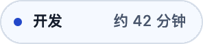

# 专注镜 v0.4.3 · 轻量悬浮胶囊（试用版）

版本：0.4.3 / build 24。Apple 芯片（arm64），macOS 14+。

## 更小的常驻浮窗

原来的活动卡片改为 **148 × 32 点的悬浮胶囊**，只显示当前活动类别与估算时长。相较 v0.4.1 默认 290 × 220 点，常驻面积减少约 93%。AI 识别的活动详情和今日累计在需要时展开查看。

- 鼠标停留 350 毫秒后展开为 220 × 144 点，移开 500 毫秒后收起；也可点击切换。
- 支持拖动移位，贴近屏幕左右边缘后缩为 **8 × 36 点的小把手**。悬停可展开查看，点击可恢复胶囊。
- 展开后保留暂停/恢复、隐藏、贴边和返回今天；隐藏浮窗不停止自动记录。
- 浮窗不成为键盘焦点或主窗口；按钮支持首击操作。只有主动点击返回今天时才打开主窗口。
- 收起时面板随可见内容一起缩小，不保留展开后的透明拦截区域。继续支持主题同步、多屏位置恢复及负坐标显示器。
- 旧外观偏好文件兼容保留，旧宽度和圆角设置不再控制胶囊，设置页移除这些已失效的控件。

## 验证与已知限制

- **72 项检查，0 失败**。新增覆盖三种显示形态、四主题布局、不获取焦点、左右贴边及展开锚点、按钮动作、隐藏与恢复、悬停延迟与取消、移出后收起和关闭清理。
- release 构建及严格签名验证通过。截图由原生控件渲染，使用虚构活动和模拟模型，不包含用户屏幕或个人记录，不代表真实模型准确率。
- 已在本机确认胶囊实际为 148 × 32 点，关闭主窗口后仍显示，前台应用保持不变。真实悬停、拖动及按钮点击的完整手势验收受原生自动化工具限制，相关逻辑由控制器和几何检查覆盖，不宣称完整实机手势均已验收。
- 测试脚本要求进程输出完整通过摘要，避免进程提前退出时误报成功。

## 下载与升级

- 下载附件 `FocusLens-macOS.zip`，解压后将 `专注镜.app` 放入「应用程序」。`SHA256SUMS.txt` 用于校验压缩包。
- 本次不改变活动数据格式、不重分类历史记录。升级前仍建议备份 `~/Library/Application Support/FocusLens/`；模型密钥独立保存在 macOS 钥匙串。
- **ad hoc 临时签名，未进行 Apple 公证。** 替换应用后可能需要在「系统设置 → 隐私与安全性 → 屏幕与系统音频录制」重新允许专注镜，并按提示退出重开。应用内保存的同意状态不等同于 macOS 系统权限。
- 估算时长不代表专注程度、工作成果或绩效。截图请求、模型授权、排除应用和本机记录策略沿用 v0.4.1。
